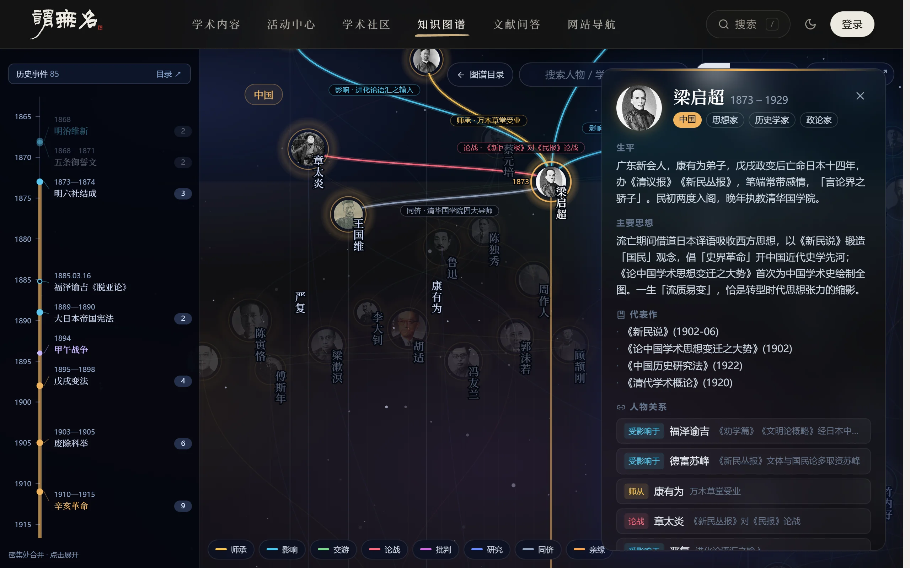
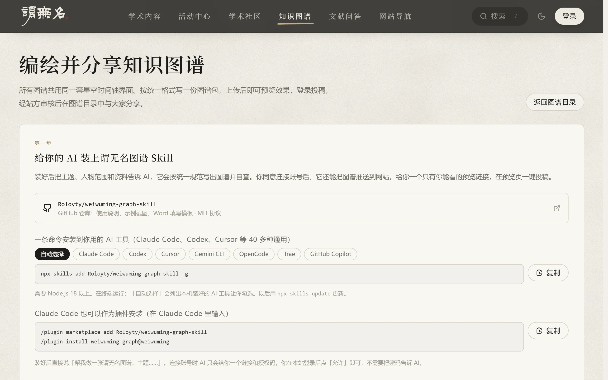
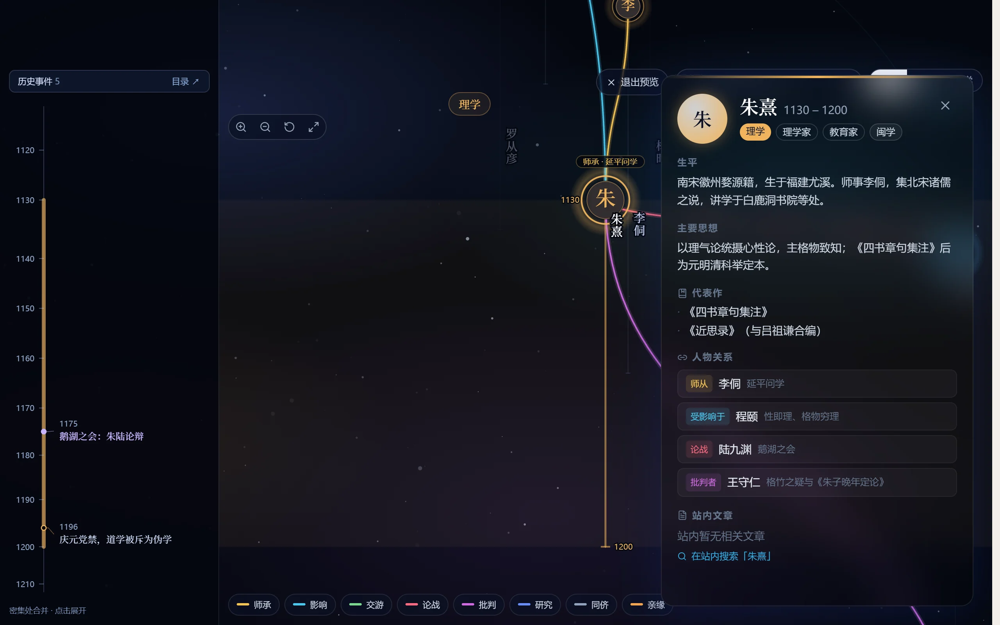
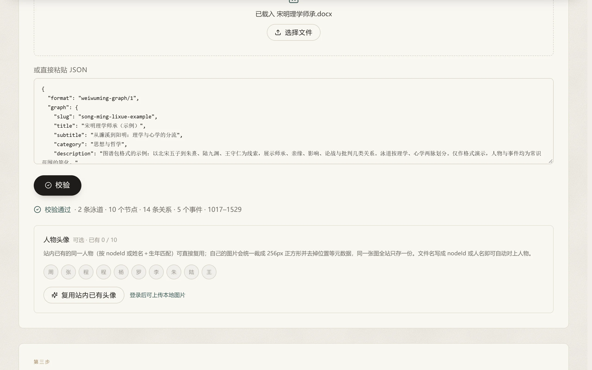

# 谓无名知识图谱 Skill

让 AI 帮你编绘一张[谓无名](https://weiwuming.cn/graph)风格的知识图谱，或者用 Word 表格自己整理，然后投稿到谓无名分享。

谓无名的知识图谱是一套统一的「星空时间轴」界面：纵轴是时间，人物头像落在生年，竖线延伸到卒年；横向按国家、学派或阵营分栏；连线是师承、影响、论战等关系；左侧是历史事件时间轴。点开人物可以看到生平、主要思想、代表作和全部关系。



你只需要告诉 AI 主题和资料，它会按统一格式写出图谱并在线校验。征得你同意后，它还能把图谱推送到网站，生成只有你能看到的预览页，由你一键投稿。站方审核通过后，图谱会出现在 [weiwuming.cn/graph](https://weiwuming.cn/graph)，署上你的名字。


## 安装

### 一条命令，适用于各种 AI 工具

在终端运行（需要 Node.js 18 或更高版本）：

```bash
npx skills add Roloyty/weiwuming-graph-skill -g
```

运行后会列出本机装好的 AI 工具让你勾选。也可以直接指定：

```bash
npx skills add Roloyty/weiwuming-graph-skill -g -a claude-code
npx skills add Roloyty/weiwuming-graph-skill -g -a codex
npx skills add Roloyty/weiwuming-graph-skill -g -a cursor
```

支持 Claude Code、Codex、Cursor、Gemini CLI、OpenCode、Trae、GitHub Copilot 等 40 多种工具（`-a` 的取值见 [skills CLI](https://github.com/vercel-labs/skills)）。以后用 `npx skills update` 更新。

### Claude Code 插件

在 Claude Code 里输入：

```
/plugin marketplace add Roloyty/weiwuming-graph-skill
/plugin install weiwuming-graph@weiwuming
```

以后在 `/plugin` 面板里更新。

### 手动安装

把 [`skills/weiwuming-graph`](skills/weiwuming-graph) 整个文件夹复制到 AI 工具读取 Skill 的目录（如 Claude Code 的 `~/.claude/skills/`），或者把其中的 `SKILL.md` 内容发给 AI。



## 用 AI 编绘

安装后直接对 AI 说，例如：

- 「帮我做一张谓无名图谱：清代浙东学派的师承，大约 30 人，资料以《清儒学案》为主」
- 「把这张图谱推送到谓无名让我看看效果」
- 「没问题了，帮我投稿」

AI 会按下面的流程走：

1. **确定范围**：主题、时间跨度、人物数量、泳道划分（如「中国 / 日本」「理学 / 心学」）、资料依据。
2. **编写图谱包**：一个 `<slug>.graph.json` 文件，格式见 [`graph.schema.json`](skills/weiwuming-graph/graph.schema.json)，示例见 [`example.json`](skills/weiwuming-graph/example.json)。
3. **校验**：调用网站的公开校验接口，逐条修正错误。
4. **连接账号**（第一次）：AI 给你一个链接和授权码。你在已登录谓无名的浏览器里打开链接、核对授权码、点「允许」。**AI 不会也不需要知道你的密码。**
5. **推送预览**：AI 给你一个预览链接。改完再推送，链接不变，刷新即可看到新版本。
6. **投稿**：在预览页点「提交审核」，或明确同意后让 AI 提交。



## 用 Word 手工填写

不想用 AI，或者习惯先在 Word 里整理资料，可以用 Word 模板：

1. 下载 [**Word 填写模板**](skills/weiwuming-graph/graph-template.docx)，参考 [填好的示例（宋明理学师承）](skills/weiwuming-graph/graph-example.docx)。
2. 按五张表填写：**图谱信息**（标题、地址、分类、简介）、**泳道**、**人物**（姓名、生卒年、身份、简介、代表作……）、**关系**（用姓名填起点和终点）、**时间轴事件**。编号、泳道标识和颜色都可以空着。
3. 打开 [weiwuming.cn/graph/submit](https://weiwuming.cn/graph/submit)，在第二步直接上传这个 Word 文件。网站会自动转换、校验并给出预览；有填错的地方会指出是哪张表的第几行。
4. 登录后投稿。

也可以把填好的 Word 交给装了这个 Skill 的 AI，让它转换、核对并帮你补全。



## 人物头像

- 大多数人物不用管：网站上已有同一人物的头像时会自动复用（按编号，或「姓名/别名＋生年」匹配）。
- 用自己的图片：放到图谱 JSON 旁边的 `avatars/<编号>.jpg`（也可以是 png、webp），推送时会自动上传；或者在网页上传页的「人物头像」里上传。服务器统一裁成 256px 正方形，并去掉照片里的位置等元数据；同一张图在全站只存一份。
- 只使用你有权使用的图片。

## 命令行助手

`skills/weiwuming-graph/wwm-graph.mjs` 由 AI 调用，你也可以自己用：

| 命令 | 作用 |
|---|---|
| `node wwm-graph.mjs from-word <file.docx>` | 把填好的 Word 模板转成图谱包并校验（`-o` 指定输出文件） |
| `node wwm-graph.mjs validate <file>` | 校验图谱包（不需要登录） |
| `node wwm-graph.mjs login` / `login --wait` | 连接谓无名账号 |
| `node wwm-graph.mjs push <file> [--write]` | 推送为草稿并给出预览链接；`--write` 把上传后的头像地址写回文件 |
| `node wwm-graph.mjs submit <草稿ID>` | 提交审核 |
| `node wwm-graph.mjs status` | 查看草稿、审核状态与审核意见 |
| `node wwm-graph.mjs withdraw <ID>` | 删除草稿或撤回待审稿 |
| `node wwm-graph.mjs logout` | 撤销本机授权 |

## 安全与隐私

- 连接账号采用授权码流程：你在网站上批准，AI 拿到的是**只能上传和投稿图谱**的令牌，不能查看或修改账号、不能发表其他内容，也不能跳过审核。
- 令牌保存在本机 `~/.weiwuming/graph-agent.json`，30 天过期。可以随时在 [weiwuming.cn/graph/submit](https://weiwuming.cn/graph/submit) 的「已连接的 AI 工具」里撤销，或运行 `logout`。
- 推送的草稿只有你本人登录后能看到；投稿须经站方审核才会公开。

## 许可协议

本仓库的代码与文档以 [MIT 协议](LICENSE) 开源：可以自由使用、修改和再分发，保留版权声明即可。

## 反馈

问题与建议请提 [Issue](https://github.com/Roloyty/weiwuming-graph-skill/issues)。本仓库的 `skills/weiwuming-graph` 与谓无名网站上的工具包保持同步。
